# 锁 · 我们的故事

一个只属于两个人的恋爱计划空间。入口是一把悬浮的黄铜锁，输入暗号后，进入由 **Vue 3** 构建、**Koa2** 提供数据服务的三块计划面板。

> 准备迁移到公网云服务器时，请先看 [DEPLOYMENT.md](DEPLOYMENT.md)。
> 如果服务器已经使用现有的 Nginx + Koa Docker 结构，请直接看 [DOCKER.md](DOCKER.md)。

## 立即预览

```bash
cp .env.example .env
# 编辑 .env，自己设置 LOVE_PASSCODE
pnpm install
pnpm dev
```

- 开发地址：<http://127.0.0.1:5173>
- 生产地址：<http://127.0.0.1:5500>
- 登录暗号：由 `.env` 中的 `LOVE_PASSCODE` 决定
- 暗号提示：一个被我们记住的日子

三个板块初始都是空白的，可以直接开始添加。

## 预览

| 见面的日子还没定 | 写下见面计划 |
| --- | --- |
| 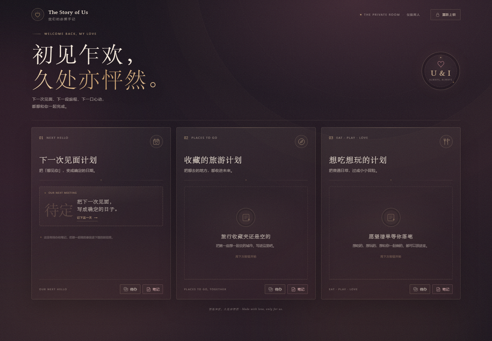 | 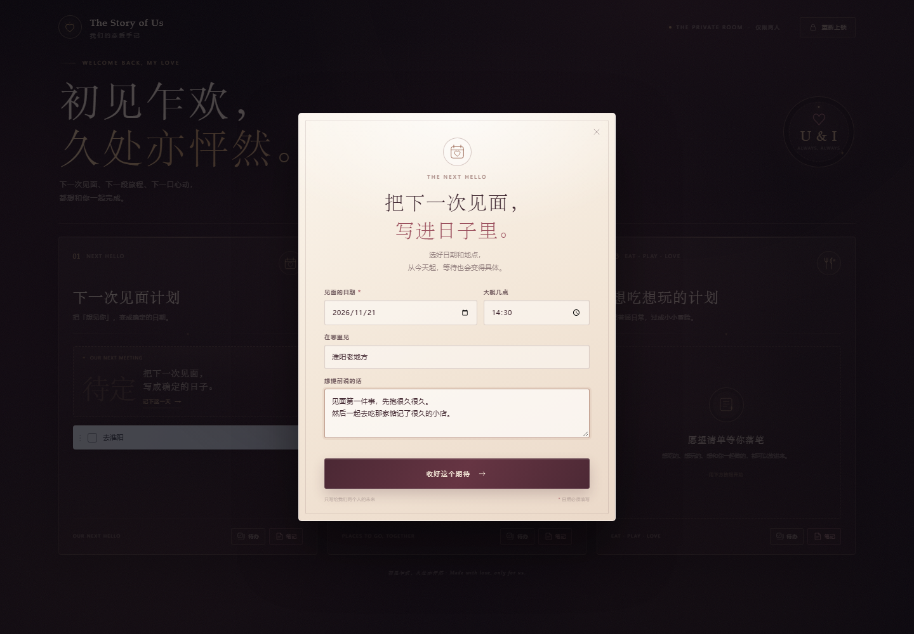 |

| 见面计划与倒计时 | 手机端 |
| --- | --- |
| 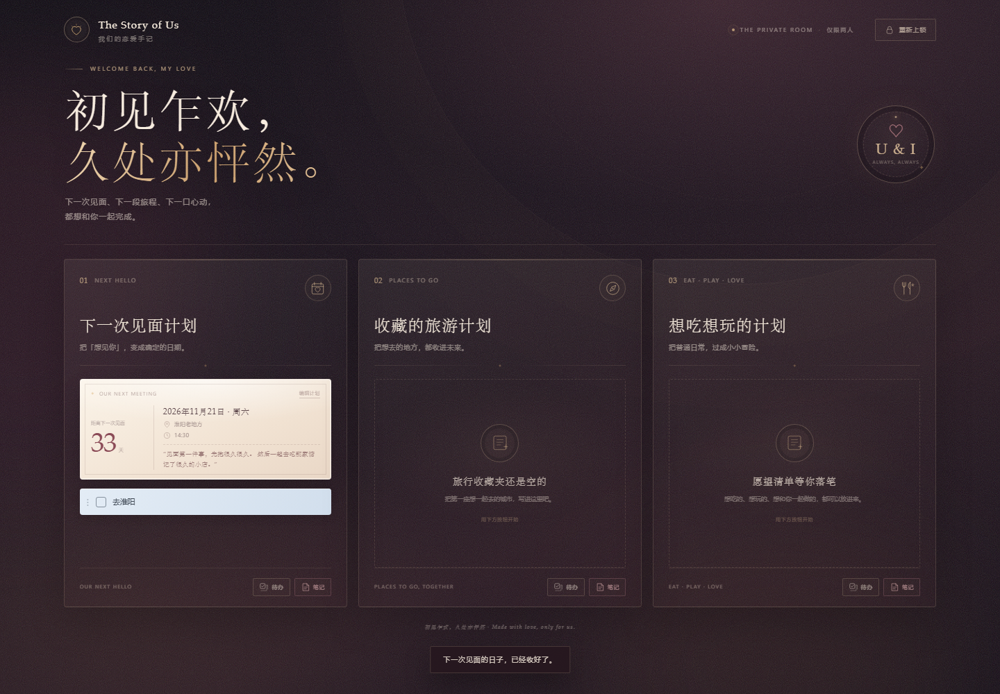 | 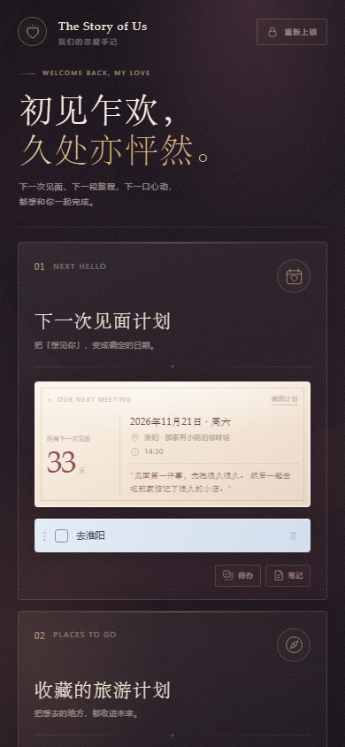 |

| 添加待办与笔记之后 | 笔记编辑器 |
| --- | --- |
| 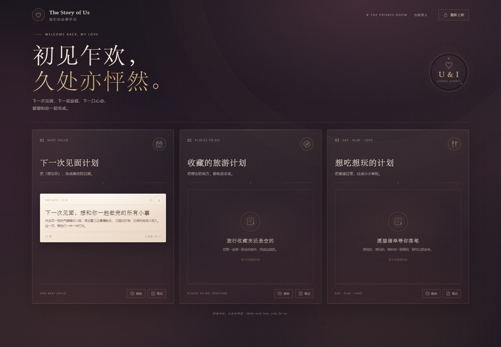 | 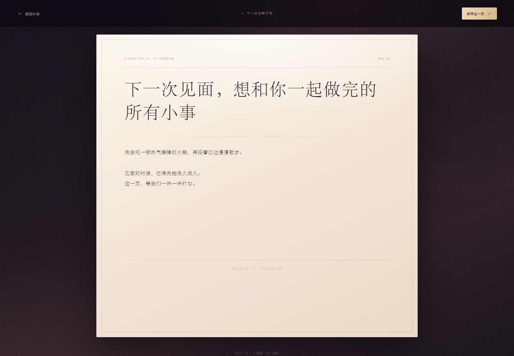 |

| 在笔记中粘贴照片 | 带照片的笔记卡片 |
| --- | --- |
| 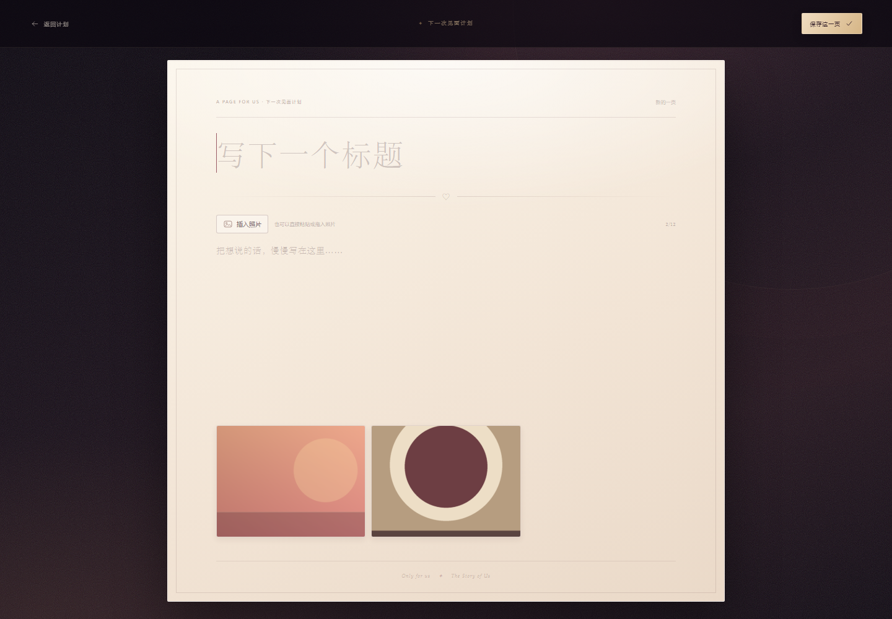 | 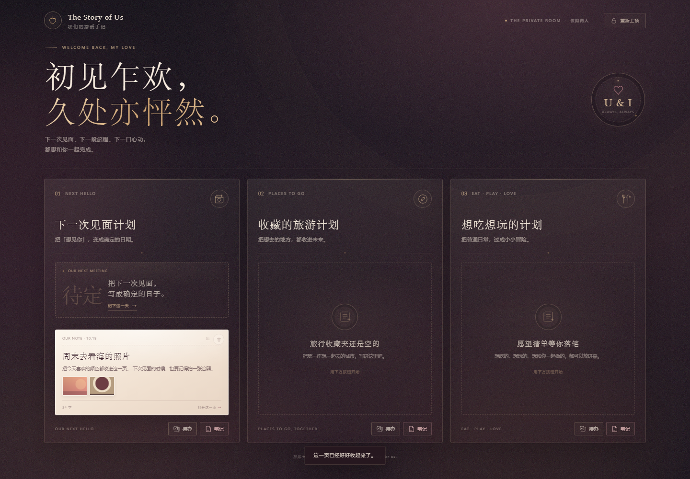 |

| 点击品牌爱心 · 满屏爱心雨 | 手机端彩蛋 |
| --- | --- |
|  | 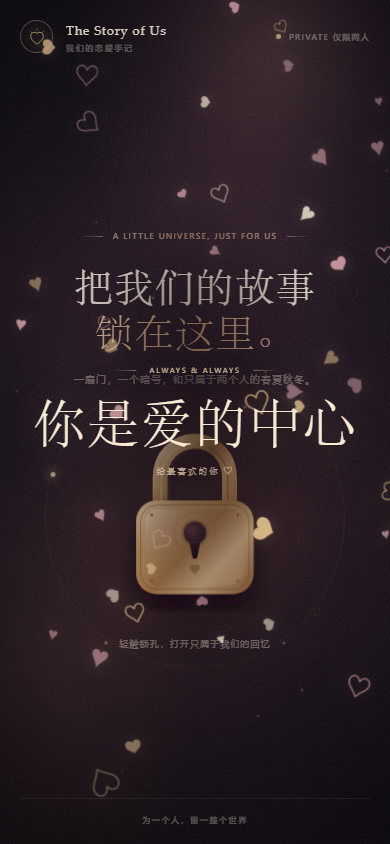 |

| 纪念照片墙 | 手机端空照片墙 |
| --- | --- |
| 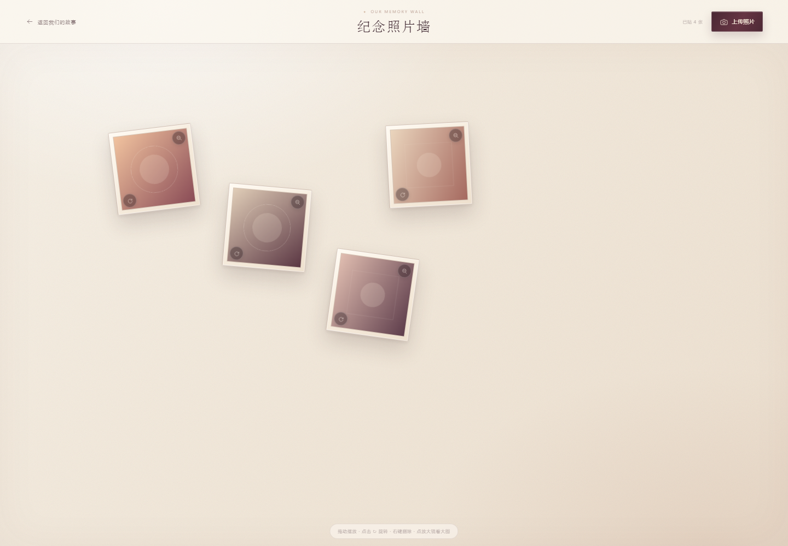 | 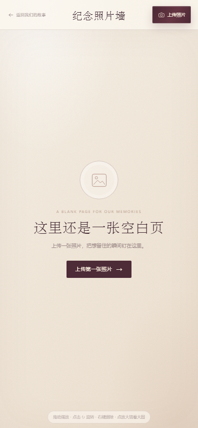 |

## 现在可以做什么

- **锁屏登录**：点击锁孔弹出拱门登录窗，暗号由 Koa2 后端验证。
- **三个空白板块**：下一次见面计划、收藏的旅游计划、想吃想玩的计划。
- **藏在品牌里的小彩蛋**：点击左上角品牌图标中的爱心，会有满屏小爱心降落约 5 秒，屏幕中央出现「你是爱的中心」的大字，停留约 2 秒后淡出。
- **纪念照片墙**：点击页面右上方的「U & I」圆形印章，会进入一张空白的照片墙页面。可以上传多张照片，照片会以固定尺寸的小方框呈现；拖动可自由摆放、长按左下角按钮可流畅连续旋转、照片互相叠放覆盖、右键可删除；每张照片右上角的放大镜可打开大图预览。照片墙页面内的字体已整体放大一号。
- **照片墙布局保存**：照片的位置、角度和叠放顺序会通过 Koa2 API 保存，再次打开照片墙仍然保持原来的摆放。
- **下一次见面计划**：可以填写见面日期、时间、地点和一句想提前说的话；保存后显示实时倒计时、日期、地点和备注，也可以随时编辑或清空。
- **添加待办**：点击板块底部的「待办」，会出现一条浅蓝色待办行，输入内容后按 Enter、点击右侧勾选，或点击空白处即可保存。
- **勾选/删除待办**：复选框可直接标记完成，行尾的删除按钮可移除待办。
- **添加笔记页面**：点击「笔记」，会打开一张可以编辑的完整纸页，支持标题和正文。保存后，它会在对应板块里变成一张笔记卡片。
- **粘贴照片**：在笔记页中可以直接粘贴图片，也可以点「插入照片」选择文件或拖入图片。支持 JPG / PNG / WEBP / GIF，每页最多 12 张；大图会在浏览器压缩后再上传。
- **照片展示**：笔记编辑器中以照片墙显示，板块里的笔记卡片会显示缩略图；删除笔记时，相关照片文件也会一起删除。
- **编辑/删除笔记**：点击笔记卡片重新打开纸页；顶部可保存、删除。离开有未保存内容的纸页时，会自动保存再返回。
- **持久化**：文字和笔记数据通过 Koa2 API 写入 `server/data.json`；照片保存在 `server/uploads/`。刷新页面、重新登录后仍然存在。
- **响应式**：桌面为三栏，平板为横向大卡片，手机自动纵向堆叠。
- **无外部 CDN**：字体、图标和背景全部本地化，离线也能正常使用。

## 技术栈

| 层 | 技术 |
| --- | --- |
| 前端 | Vue 3（`<script setup>`）+ Vite 8 |
| 后端 | Koa 2 + `@koa/router` + `koa-bodyparser` |
| 数据 | 本地 JSON 文件（`server/data.json`）+ 照片文件（`server/uploads/`） |
| 鉴权 | 登录后发放临时 Bearer Token，同时写入 HttpOnly 会话 Cookie；12 小时有效 |

## 本地运行

先复制环境变量模板并设置只有你们知道的暗号：

```bash
cp .env.example .env
# 修改 .env 里的 LOVE_PASSCODE
pnpm install
pnpm dev
```

开发模式会同时启动：

- Koa2 API：<http://127.0.0.1:5500>
- Vue / Vite 页面：<http://127.0.0.1:5173>（`/api` 和 `/uploads` 自动代理到 Koa）

生产预览使用单端口：

```bash
pnpm build
pnpm start
# http://127.0.0.1:5500
```

如果使用现有服务器的 Docker Compose 结构：

```bash
pnpm build
docker compose up -d
# 默认 http://服务器IP:8081
```

详见 [DOCKER.md](DOCKER.md)。

## 配置

| 环境变量 | 默认值 | 说明 |
| --- | --- | --- |
| `LOVE_PASSCODE` | 必填 | 登录暗号；未设置时 Koa 会拒绝启动 |
| `PORT` | `5500` | Koa 监听端口 |
| `HOST` | `127.0.0.1` | Koa 监听地址 |

`.env` 已被 Git 忽略，不会上传暗号。参考模板：[.env.example](.env.example)。

## 数据存储

运行时数据文件 `server/data.json` 已加入 `.gitignore`，不会上传到仓库。空数据模板见 `server/data.example.json`：

```json
{
  "meeting": {
    "plan": { "date": "", "time": "", "place": "", "note": "", "updatedAt": null },
    "todos": [],
    "notes": []
  },
  "travel": { "todos": [], "notes": [] },
  "wish":   { "todos": [], "notes": [] },
  "memories": []
}
```

笔记内的照片以文件形式保存在 `server/uploads/`，JSON 中只记录照片地址、文件名和创建时间：

```json
{
  "title": "海边见面的照片",
  "content": "这一页留给海边。",
  "images": [
    { "url": "/uploads/xxxx.webp", "name": "照片.webp", "createdAt": "..." }
  ]
}
```

每次增删改都会自动写回该文件。首次启动时会自动创建该文件。不要直接编辑正在运行的服务数据；需要清空时先停止服务再重置文件。照片由 Koa2 通过会话 Cookie 鉴权后读取，并设置 `no-store`，退出登录后旧图片地址会失效。

照片墙中的每个条目包含照片信息，以及 `x`、`y`（0–1 的归一化位置）、`rotation`（角度）和 `z`（叠放顺序）：

```json
{
  "id": "…",
  "image": { "url": "/uploads/xxxx.webp", "name": "照片.webp", "createdAt": "..." },
  "x": 0.34,
  "y": 0.42,
  "rotation": 8,
  "z": 3
}
```

## API

除 `/api/login` 和 `/api/health` 外，都需要 `Authorization: Bearer <token>`。

| 方法 | 路径 | 作用 |
| --- | --- | --- |
| `POST` | `/api/login` | 校验暗号并返回 token，同时写入会话 Cookie |
| `POST` | `/api/logout` | 注销 token 并清除会话 Cookie |
| `GET` | `/api/board` | 获取全部板块 |
| `PUT` | `/api/sections/meeting/plan` | 保存 / 更新 / 清空见面计划 |
| `POST` | `/api/uploads` | 上传照片（原始二进制，最大 10MB） |
| `GET` | `/uploads/:file` | 读取照片（Bearer 或 Cookie 鉴权） |
| `GET` | `/api/memories` | 获取照片墙布局 |
| `POST` | `/api/memories` | 新建照片墙条目 |
| `PATCH` | `/api/memories/:id` | 保存拖动位置、旋转角度和叠放顺序 |
| `DELETE` | `/api/memories/:id` | 删除照片墙条目及照片文件 |
| `POST` | `/api/sections/:section/todos` | 新建待办 |
| `PATCH` | `/api/sections/:section/todos/:id` | 修改待办内容 / 完成状态 |
| `DELETE` | `/api/sections/:section/todos/:id` | 删除待办 |
| `POST` | `/api/sections/:section/notes` | 新建笔记页面 |
| `PATCH` | `/api/sections/:section/notes/:id` | 更新笔记标题 / 正文 |
| `DELETE` | `/api/sections/:section/notes/:id` | 删除笔记 |

`section` 取值为 `meeting`、`travel`、`wish`。

## 目录

```text
.
├─ index.html                 # Vite 入口
├─ src/
│  ├─ App.vue                 # 登录、数据、页面状态与 API 调用
│  ├─ api.js                  # 前端 API / 照片上传封装
│  ├─ assets/styles.css       # 全部视觉样式
│  ├─ data/sections.js        # 三个板块的文案配置
│  ├─ utils/images.js         # 图片压缩与预处理
│  └─ components/
│     ├─ LockScene.vue        # 锁屏入口
│     ├─ LoginModal.vue       # 登录弹窗
│     ├─ DashboardView.vue    # 秘密基地与三栏布局
│     ├─ PlanPanel.vue        # 待办 + 笔记面板
│     ├─ MeetingPlanCard.vue  # 见面计划倒计时卡片
│     ├─ MeetingPlanDialog.vue# 见面计划编辑弹窗
│     ├─ MemoryWall.vue       # 可拖拽 / 旋转的纪念照片墙
│     ├─ LoveEasterEgg.vue    # 品牌爱心彩蛋
│     └─ NoteEditor.vue       # 整页笔记 / 照片编辑器
├─ server/
│  ├─ index.js                # Koa2 API、鉴权与静态文件服务
│  ├─ data.json               # 持久化数据
│  └─ uploads/                # 上传的照片文件
└─ vite.config.js
```

## 说明

当前实现适合本地或私密使用：鉴权 token 只存在服务端内存，服务重启或刷新页面后需要重新输入暗号；数据保存在 JSON 文件中，没有数据库和并发写入保护；照片只限制格式和大小，没有做病毒扫描。若部署到公网，建议补充 HTTPS、密码哈希、登录限流、数据库、图片 CDN / 对象存储和备份策略。

照片的缩略图与编辑页共用原文件；目前没有生成缩略图或多分辨率版本。新建笔记后如果上传照片又放弃整页且不保存，可能留下未被引用的照片文件，可在后续加清理任务。照片墙上的照片位置按画布宽高的归一化坐标保存，因此窗口大小改变时会留在相对位置，但不会自动避免照片在极小屏幕上重新重叠。
